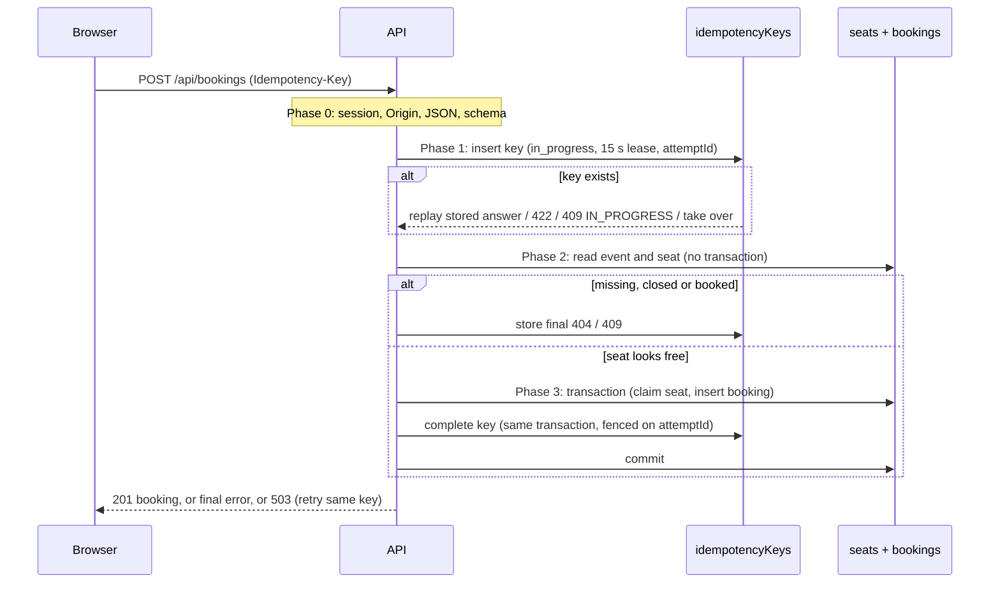

# Booking correctness

> **Authority:** how Seatly guarantees invariants INV-1 to INV-5 ([rules-and-flows.md](../product/rules-and-flows.md#invariants)) under concurrency, retries and failures.
> **Status:** verified against `apps/api/src/modules/bookings/` and its tests on 26 Oct 2026.

## The guarantee in plain words

Whoever's write reaches the database first gets the seat; everyone else is told "taken". A repeated request (same idempotency key) gets the first request's answer instead of being run again. If anything fails halfway, nothing is saved, so a seat is never booked without a booking. None of this depends on the browser behaving, on timing, or on how many server processes are running.

## Three layers of defence

| Layer | What it does | Where |
| --- | --- | --- |
| 1. **Conditional claim** | `Seat.findOneAndUpdate({ eventId, seatId, status: 'available' }, { $set: { status: 'booked', bookingId, bookedAt } })`. Among concurrent requests, exactly one matches; the rest match nothing and get 409 `SEAT_TAKEN`. | `service.ts` → `runAttempt` |
| 2. **Unique index** | `bookings(eventId, seatId)` is unique. Even buggy code cannot store a second booking for a seat; if it ever tried, the attempt aborts and logs `INVARIANT_ALERT`. | `db/models.ts` |
| 3. **One transaction** | Seat claim, booking insert and idempotency-key completion run in one MongoDB transaction (snapshot read, majority write). All three commit or none do. | `service.ts` → `transactionLoop` |

Layer 1 decides the winner; layer 2 is a safety net; layer 3 keeps the seat, the booking and the stored answer consistent with each other.

## Request phases

| Phase | Work | Outcomes |
| --- | --- | --- |
| 0 | Session (user from the cookie only), `Origin` check, JSON body, strict schema (`userId` rejected), key is a UUID | 401, 403, 415, 400 |
| 1 | **Claim the key:** insert `{ userId, operation: 'booking.create', key, fingerprint, status: 'in_progress', attemptId, lockedUntil: now + 15 s }` | See [key states](#idempotency-key-rules) |
| 2 | **Fast path:** event exists? event not yet started? seat exists? seat not already booked? | Final 404 `EVENT_NOT_FOUND` / 409 `BOOKING_CLOSED` / 404 `SEAT_NOT_FOUND` / 409 `SEAT_TAKEN`, stored on the key |
| 3 | **Transaction loop:** up to 5 attempts within a 4 s deadline; backoff of random 10–50 ms × attempt number; retries on `TransientTransactionError` (and on the near-impossible booking-reference collision); commit retried up to 3 times on `UnknownTransactionCommitResult` | 201, or 409 `SEAT_TAKEN` if the claim matched nothing |
| 4 | **Non-final failure:** fenced delete of the key so a same-key retry starts fresh | 503 `BOOKING_UNAVAILABLE` + `Retry-After: 1`, or 500 |

Phase 2 reads without a transaction. That is safe because in V1 a booked seat never becomes available again: a stale "available" read only sends the request to phase 3, where the conditional claim decides.

## Idempotency key rules

Keys are unique per (user, operation, key) and expire 24 h after creation (TTL index). The **fingerprint** is a hash of the normalised event ID and seat ID.

| Same key arrives and… | Response | Why |
| --- | --- | --- |
| No record | Claimed; request proceeds | First attempt |
| Different fingerprint | 422 `IDEMPOTENCY_KEY_REUSED` | A key belongs to one request body |
| Completed | Stored status and body, `Idempotent-Replayed: true` | Answers never change (INV-4) |
| In progress, lease valid | 409 `IDEMPOTENCY_IN_PROGRESS`, `Retry-After: 1` | Another process is working on it |
| In progress, lease expired | Taken over: new `attemptId`, new lease, request proceeds | The previous worker crashed or stalled |

**Fencing:** every write after the claim (`complete`, `release`) matches on `{ attemptId, status: 'in_progress' }`. A stalled worker whose lease was taken over finds no match, gets `LeaseLostError`, and its transaction aborts, so it cannot overwrite the new owner's result (tested in `idempotency.test.ts`).

**Unknown commit result:** if the commit's outcome is unknown after its retries, the key is **not** released. The booking may have landed, so releasing it could let a retry book a second seat. The client gets 503 and retries with the same key. If the commit landed, the key was completed in that same transaction, so the retry gets the stored replay. If it did not land, the key is still *in progress*: the retry gets 409 `IN_PROGRESS` until the 15 s lease expires, then takes over and books normally.

## Timeouts and retries end to end

| Where | Value | Effect |
| --- | --- | --- |
| Each database operation in the transaction | 2 s (`maxTimeMS`, `maxCommitTimeMS`) | Stops one slow step from using the whole budget |
| Server booking deadline | 4 s (`BOOKING_DEADLINE_MS`) | No new transaction attempt starts after this; then 503 |
| Key lease | 15 s (`IDEMPOTENCY_LEASE_MS`) | Longer than the deadline, so a live worker never loses its lease |
| Client request timeout | 10 s | Treated as "outcome unknown" |
| Client retries | +1 s, +3 s (+0–250 ms jitter), **same key** | Recovers from timeouts, network errors and 5xx |
| Client in-progress polls | Up to 5, at the server's `Retry-After` | Waits out a concurrent same-key request |
| Client "Try again" | Same key, as many times as the user wants | Safe by construction |

A new key is created only when the user presses **Book** for a new attempt. Retries, polls, "Try again" and a resume after page reload all reuse the stored key (`apps/web/src/features/booking/useBookingAttempt.ts`).

## Failure cases and what happens

| Failure | Result | Evidence |
| --- | --- | --- |
| Two users, one seat, same moment | One 201, one 409 `SEAT_TAKEN` | `concurrency.test.ts` (50 users); CI demo (300 users, two processes) |
| Same user, same key, 20 parallel requests | One booking; other responses are 201 replays or 409 `IN_PROGRESS` | `idempotency.test.ts` (AC-19) |
| Crash after the seat claim, before commit | Transaction aborted; seat still available; key released | `transaction-failures.test.ts` (AC-21) |
| Transient write conflict | Retried within the deadline; books once | `transaction-failures.test.ts` (fail point) |
| All 5 attempts fail | 503; nothing written; same key later succeeds | `transaction-failures.test.ts` |
| Commit result unknown | Commit retried; books once | `transaction-failures.test.ts` |
| Primary shutting down during commit | 201 or a safe 503; never two bookings | `transaction-failures.test.ts` |
| Response lost after commit | Same-key retry gets the replay; still one booking | `transaction-failures.test.ts` |
| Worker stalls past its lease | Retry takes over; the stale worker cannot complete | `idempotency.test.ts` |
| Event starts while the user is choosing | Final 409 `BOOKING_CLOSED`; nothing booked | `event-lifecycle.test.ts` (AC-28) |

After every API integration test, `expectInvariantHolds` scans the whole database for any seat or booking that breaks INV-1 or INV-2.

## Limits

- Correctness rests on MongoDB transactions with majority write concern. A single-node replica set (local, CI) has no failover; Atlas's three-node cluster does. Failover itself is not tested.
- The fast path assumes seats never return to *available*. **V2 cancellation would break that assumption**: the phase 2 read would then need to move inside the transaction, or the "already booked" shortcut would need removing. See [ADR-0003](../adr/0003-one-transaction.md).
- No limit on how many bookings one user can make.

Decisions behind this design: [ADR-0001](../adr/0001-replica-set-transactions.md), [0002](../adr/0002-conditional-claim-unique-index.md), [0003](../adr/0003-one-transaction.md), [0004](../adr/0004-idempotency-keys.md).
