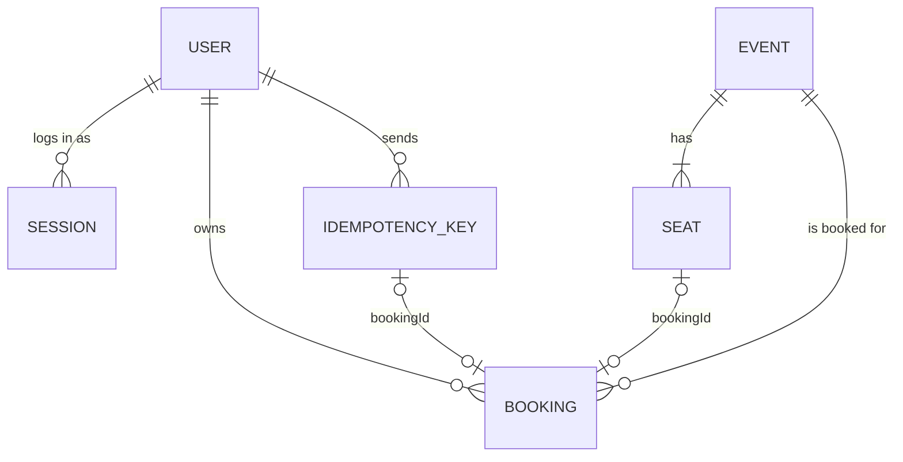

# Data model

> **Authority for field definitions:** [`apps/api/src/db/models.ts`](../../apps/api/src/db/models.ts). This document explains them, their indexes and their lifecycle; if the two disagree, the code wins and this file must be fixed.
> **Status:** verified 26 Oct 2026.

## Collections

| Collection | Purpose | Key fields | Indexes (all named; unique ones marked U) |
| --- | --- | --- | --- |
| `users` | Accounts | `name` (≤ 80), `email` (lower-case), `passwordHash` (argon2id, never selected by default), `createdAt` | `email_unique` U |
| `sessions` | Logins | `tokenHash` (SHA-256 of the cookie token), `userId`, `lastSeenAt`, `idleExpiresAt`, `absoluteExpiresAt`, `expiresAt` | `tokenHash_unique` U, `userId`, `expiresAt_ttl` (TTL 0 s) |
| `events` | Shows | `slug`, `title`, `description`, `venue`, `imageUrl`, `imageAlt`, `startsAt`, `endsAt`, `timezone`, `layout { rows[], seatsPerRow ≤ 99 }`, `totalSeats` | `slug_unique` U, `startsAt` |
| `seats` | One document per seat | `eventId`, `seatId` (`^[A-Z](?:[1-9]\|[1-9][0-9])$`), `row`, `number`, `status` (`available` \| `booked`), `bookingId`, `bookedAt` | `event_seat_unique` U, `event_status` |
| `bookings` | Who owns which seat | `reference` (`SEAT-XXXX-XXXX`), `userId`, `eventId`, `seatId`, `idempotencyKeyId`, `createdAt` | `event_seat_unique` U, `reference_unique` U, `user_createdAt` |
| `idempotencyKeys` | Booking request outcomes | `userId`, `operation` (`booking.create`), `key`, `fingerprint`, `status` (`in_progress` \| `completed`), `attemptId`, `lockedUntil`, `response { statusCode, body }`, `bookingId`, `createdAt`, `completedAt`, `expiresAt` | `user_op_key_unique` U, TTL on `expiresAt` |

Seat availability is never stored as a counter. It is counted from seat documents on each read, so it cannot drift.

## Indexes and schema changes

- `autoIndex` is off. At startup the server runs `syncIndexes` (`apps/api/src/db/connection.ts`), which creates missing indexes and drops ones not declared in the models. A unique index that cannot be built (because duplicates exist) **fails startup** rather than silently allowing duplicates.
- There are no migration files ([ADR-0009](../adr/0009-sync-indexes-no-migrations.md)). The seed is idempotent: events by `slug`, seats by `(eventId, seatId)`, house bookings by `(eventId, seatId)`.
- **Changing a model:** add fields with defaults so old documents stay valid. Renames and type changes need a one-off script; add one under `apps/api/scripts/` and record it in the [CHANGELOG](../../CHANGELOG.md).

## Lifecycle and retention

| Data | Created | Changed | Removed |
| --- | --- | --- | --- |
| User | Register | Never (no profile editing) | Never automatically; only by hand in Atlas ([personal-data.md](../security/personal-data.md)) |
| Session | Login or register | `lastSeenAt` and idle expiry moved forward at most every 5 min | Logout, new login in the same browser, or TTL after idle (120 min) or absolute (7 days) expiry |
| Event | Seed | Live demo: started seeded events move forward by 7-week steps ([ADR-0012](../adr/0012-booking-closes-at-start.md)) | Never |
| Seat | Seed | `available` → `booked` once | Never |
| Booking | Booking transaction | Never | Never |
| Idempotency key | Booking request | `in_progress` → `completed`, or lease takeover | Released on retryable failure; TTL 24 h after creation |

## Seed data

`apps/api/src/db/seed.ts` creates 7 events (6 with rows A–F × 10 seats, plus "Last Seat Standing" with one seat; 361 seats in total), and a house account that owns pre-booked seats so availability looks realistic. Event dates are set relative to the first seed run (14 to 45 days ahead) and are not changed by later seeds. Running the seed also moves any started event forward (`rollDemoDates`).
