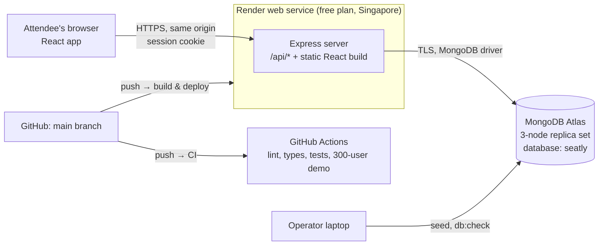

# Architecture overview

> **Authority:** how the parts of Seatly fit together and where they run. Details live in the linked documents.
> **Status:** verified against the code on 26 Oct 2026 (V1, including the V1.1 fixes in [CHANGELOG](../../CHANGELOG.md)).

## In one paragraph

Seatly is one Node.js process that serves both a JSON API (`/api/*`) and the built React app, backed by one MongoDB replica set. Every booking goes through a single database transaction that claims the seat, writes the booking and stores the request's result under its idempotency key. Because the database decides, any number of API processes can run side by side without coordinating. There are no queues, caches, background workers or other services.

## System context

## Components

| Component | Responsibility | Code |
| --- | --- | --- |
| **Web app** (React 19, Vite) | Screens, seat selection, booking attempts with same-key retries, live seat map polling | `apps/web/src` |
| **API** (Express 5) | Auth and sessions, events and seats, idempotent booking, error envelope, security headers | `apps/api/src` |
| **Shared package** | Zod schemas, error codes, DTO types used by both sides, so validation and error handling cannot drift | `packages/shared/src` |
| **MongoDB** | The single source of truth; enforces uniqueness and runs the booking transaction | Models in `apps/api/src/db/models.ts` |
| **Scripts** | Seed, database check, demo reset, concurrency and idempotency demos | `apps/api/scripts` |

## Main data flows

1. **Browse:** `GET /api/events` → events not yet started, with seat counts computed from seat documents → event cards.
2. **Choose:** `GET /api/events/:id` and `/seats` → seat map, refreshed every 10 s while visible ([ADR-0010](../adr/0010-seat-map-polling.md)).
3. **Book:** `POST /api/bookings` with an `Idempotency-Key` → key claimed → fast checks → transaction → stored outcome → 201 or a final error. Full sequence: [booking-correctness.md](booking-correctness.md).
4. **Review:** `GET /api/me/bookings`, `GET /api/bookings/:id` → owner-only reads.

## Deployment topology

| Environment | Web and API | Database | Notes |
| --- | --- | --- | --- |
| Local development | `npm run dev`: Vite on :5173 proxies `/api` to the API on :4000 | Docker `mongo:8.0`, single-node replica set `rs0` | See [repository guide](../development/repository-guide.md) |
| Tests | In-process Express via supertest; web tests use a fake API (MSW) | Same Docker replica set, one database per test worker | See [testing](../development/testing.md) |
| CI | GitHub Actions on every push | Docker replica set in the runner | Also runs the 300-user demo across two API processes |
| Production (live demo) | One Render web service: `https://seatly-02yb.onrender.com` | MongoDB Atlas free cluster | See [deployment](../operations/deployment.md) |

Same-origin serving is deliberate: the session cookie stays first-party and no CORS setup is needed ([ADR-0006](../adr/0006-single-origin.md)).

## Non-functional requirements

Defined in [requirements.md](../product/requirements.md#non-functional-requirements) (NFR-1 to NFR-10). In short: correctness with any number of processes (verified with two), a 4 s server-side booking deadline, 10 s client timeout with two same-key retries, 120-minute idle sessions, and accepted free-tier cold starts of about 50 s. No throughput, latency or uptime targets are set for V1.

## Where to read next

| Topic | Document |
| --- | --- |
| Why no double booking is possible | [booking-correctness.md](booking-correctness.md) |
| Collections, indexes, retention | [data-model.md](data-model.md) |
| Endpoints and errors | [api.md](api.md) |
| Backend modules, frontend structure, state | [application.md](application.md) |
| Why things are the way they are | [Decision records](../adr/README.md) |
| Threats and defences | [threat-model.md](../security/threat-model.md) |
