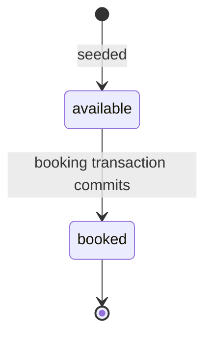
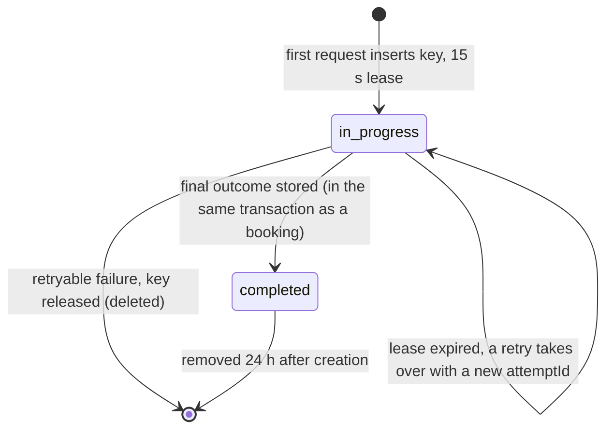
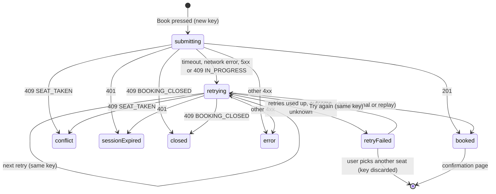

# Rules, roles and flows

> **Authority:** who can do what, the business rules, what must always be true, the states things move through, and how each user journey ends, including failures.
> **Status:** describes **verified V1 behaviour** (code and tests as of 26 Oct 2026) unless a row says *Gap* or *Proposed*. Requirement IDs (AC-n) are defined in [requirements.md](requirements.md).

## Glossary

| Term | Meaning |
| --- | --- |
| **Event** | A show with a start and end time, a venue, a time zone and a seat layout (rows × seats per row). Created only by the seed script in V1. |
| **Seat** | One place in one event, identified by row letter and number, e.g. `A7`. Either *available* or *booked*. |
| **Booking** | The record that a user owns a seat. Has a public **reference** like `SEAT-7KQ4-M2XP`. |
| **Selection** | The seat a user has clicked. It is only an intention: it does **not** hold the seat. |
| **Booking attempt** | One press of **Book**, including any automatic retries. Every attempt has exactly one idempotency key. |
| **Idempotency key** | A random UUID the browser sends with a booking request so the server can recognise repeats of the same attempt. |
| **Replay** | The server returning the stored result of an earlier request with the same key, marked `Idempotent-Replayed: true`. |
| **Lease** | A 15-second claim on an idempotency key by the server process working on it. Prevents two processes handling the same attempt at once. |
| **Final outcome** | A result that will never change if repeated: booked, seat taken, event or seat not found. Stored with the key and replayed. |
| **Retryable outcome** | A result that may change on retry: request still in progress, temporary failure (503), timeout. Not stored as final. |
| **Session** | A login, represented by a random token in an HttpOnly cookie. The server stores only a hash of it. |
| **Intent** | A seat chosen before logging in, carried through login in the URL (`?seat=A7`), then re-checked against fresh availability. |
| **House account** | A seed-only user that owns the pre-booked seats so the demo looks lived-in. Nobody can log in as it. |

## Roles and access

V1 has no roles in the database: a person is either a guest or signed in. Operator access happens outside the app (Render dashboard, Atlas, local scripts).

| Action | Guest | Signed-in user | Owner of the booking | Operator (outside the app) |
| --- | --- | --- | --- | --- |
| View event list, event details, seat map | ✓ | ✓ | ✓ | ✓ |
| Register, log in | ✓ | — (redirected home) | — | — |
| Log out | ✓ (no effect) | ✓ | ✓ | — |
| Select a seat | ✓ (kept as intent) | ✓ | ✓ | — |
| Book a seat | — → sent to log in (AC-14) | ✓ | ✓ | — |
| See **My bookings** | — → sent to log in (AC-6) | ✓ (own only, AC-24) | ✓ | — |
| See one booking | — → sent to log in | **404**, same as a nonexistent ID (AC-25) | ✓ | Via the database |
| Seed or re-seed events | — | — | — | ✓ (laptop, `npm run seed`) |
| Run demo scripts (they reset the demo event) | — | — | — | ✓ local only, `DEMO_MODE=true`; never against production |
| Delete a user or booking | — | — | — | Only by hand in Atlas (no procedure yet; see [requirements gaps](requirements.md#known-gaps-against-these-requirements)) |

**Ownership rule:** the user who owns a booking is always the session user at the time of booking. A `userId` sent by the client is rejected with 400, never ignored (AC-13).

## Business rules

| ID | Rule | Enforced in |
| --- | --- | --- |
| BR-1 | One booking holds exactly one seat. | `createBookingSchema` (`packages/shared/src/schemas.ts`) |
| BR-2 | A seat goes from *available* to *booked* only through a successful booking. Nothing returns it to *available* in V1 (no cancellation). | Booking service |
| BR-3 | The booking user comes only from the session. | Schema (strict), `apps/api/src/modules/bookings/routes.ts` |
| BR-4 | Seat IDs are one capital letter and a number 1–99 (`A1`…`Z99`). Input is trimmed and upper-cased first, so `a7` means `A7`. | `seatIdSchema` |
| BR-5 | Email is trimmed, lower-cased and unique. Name is 1–80 characters after trimming. Password is 8–72 characters. | `registerSchema`, `email_unique` index |
| BR-6 | Wrong email and wrong password get the same message and similar response time. | Auth service |
| BR-7 | Booking references look like `SEAT-XXXX-XXXX` (Crockford base32, no easily confused letters) and are unique. | `newBookingReference`, `reference_unique` index |
| BR-8 | An idempotency key is a UUID, scoped to one user and one operation (`booking.create`), and kept for 24 h. The same key from two different users is two different attempts. | `user_op_key_unique` index |
| BR-9 | A key's request is fingerprinted from the normalised event ID and seat ID. The same key with a different fingerprint is rejected with 422 (AC-18). | `bookingFingerprint` |
| BR-10 | Final outcomes (201, 404, 409 `SEAT_TAKEN`, 409 `BOOKING_CLOSED`) are stored with the key and replayed. Retryable outcomes (503, in progress, crashes) are not stored; a retry runs again. | Booking service, phases 1–4 |
| BR-11 | Selecting a seat never holds it. It is yours only once booked. | UI copy and API design |
| BR-12 | After login or session expiry, a remembered seat is restored only if a fresh seat map shows it still available (AC-14, AC-15). Booking is never submitted automatically. | `EventDetailsPage` |
| BR-13 | Only events that have not started are listed, by start time. Booking is open while the event's start time is in the future; after that its page shows "Booking has closed" and the API answers 409 `BOOKING_CLOSED` (AC-28; changed 26 Oct 2026, previously started events stayed listed and bookable). On the live demo, started seeded events move forward in 49-day steps. | `apps/api/src/modules/events/service.ts` (`isBookingOpen`), `db/seed.ts` (`rollDemoDates`) |
| BR-14 | My bookings lists the user's bookings newest first (AC-24). | `user_createdAt` index |
| BR-15 | Event dates and times are shown in the event's own time zone (seeded as Asia/Kolkata). "Booked on" is shown in the viewer's time zone. | `apps/web/src/lib/format.ts` |
| BR-16 | Login and register are limited to 10 requests per minute per IP (off in tests and demo mode). | Auth routes |
| BR-17 | A session ends after 120 minutes without activity or 7 days after login, whichever comes first. Logging in replaces the previous session in that browser. | Session middleware, auth service |
| BR-18 | A malformed event ID gets the same 404 as an unknown one (AC-9). | Events service |

## Invariants

These must hold at every moment, including after crashes and under any concurrency. After every API integration test, a check scans the whole database for violations (`expectInvariantHolds` in `apps/api/test/helpers/app.ts`).

| ID | Invariant | Guaranteed by |
| --- | --- | --- |
| INV-1 | At most one booking exists per (event, seat). | Conditional seat claim + unique index `bookings(eventId, seatId)` |
| INV-2 | A seat is *booked* if and only if exactly one booking points to it, and the seat records that booking's ID. | One transaction for seat, booking and key |
| INV-3 | One request per (user, operation, key) can be in progress at a time. | Unique index on keys + lease + fencing token |
| INV-4 | A *completed* key always has its stored response, and that response never changes. | Key completed inside the booking transaction |
| INV-5 | Every booking belongs to the user whose session made the request. | BR-3 |

How these are enforced is explained in `architecture/booking-correctness.md` (Stage C).

## State transitions

### Seat

There is no path back to *available* in V1. A failed transaction leaves the seat *available* (AC-21).

### Idempotency key (server)

When a commit's result is unknown, the key is **kept** in progress rather than released, so a retry cannot book twice. The lease then decides: a retry either replays the stored outcome or takes over after 15 s.

### Booking attempt (browser)

The key lives in `sessionStorage` until a definitive answer, so a page reload during *submitting* or *retrying* resumes with the same key. Code: `apps/web/src/features/booking/useBookingAttempt.ts`.

### Session

Active while requests arrive at least every 120 minutes, for up to 7 days. Ends on logout, idle expiry, absolute expiry, or a new login in the same browser. Expired sessions are removed automatically by a database TTL index.

## User journeys

Each journey ends in exactly one place, and nothing in any path can create a second booking.

| # | Journey | Path | Ends with | Requirements |
| --- | --- | --- | --- | --- |
| J1 | Browse and book | Event list → event → select seat → **Book seat A7** → confirmation | Booking reference shown; booking in My bookings | AC-8, AC-10 |
| J2 | Lose the race | … → Book → someone else booked it first | "Seat A7 was just taken"; map refreshed; selection cleared | AC-11 |
| J3 | Book while logged out | Select seat → **Log in to book A7** → log in or register → back to the event | Seat re-selected if still free ("still available" notice) or not ("no longer available" notice); user presses Book again | AC-14 |
| J4 | Session expired at Book | Book → 401 → "Your session expired" → log in again → back to the event | Same as J3 | AC-15 |
| J5 | Slow or dropped connection | Book → no answer in 10 s → "Still checking your booking…" → automatic retries at +1 s and +3 s with the same key | Booked (replay if the first try had worked), or J6 | AC-17, AC-20 |
| J6 | Outcome still unknown | Retries used up → "We couldn't confirm your booking" | **Check My bookings** or **Try again** (same key, so it cannot double-book) | NFR-3 |
| J7 | Reload during an attempt | Page reload while submitting | Same attempt resumes with the stored key | — (tested in `booking.test.tsx`) |
| J8 | Seat taken while choosing | Seat selected; another user books it; next refresh (≤ 10 s, or on window focus) | "Seat A7 was just booked"; selection cleared; no focus jump | AC-27 |
| J9 | Sold-out event | Open event | Seat map all booked; "Sold out" with a link to other events | AC-8 |
| J10 | Review bookings | My bookings → a booking | Booking details with reference, event, seat, booked-on time | AC-24 |
| J11 | Someone else's booking link | Open `/bookings/<their id>` | Not-found message, identical to an ID that does not exist | AC-25 |
| J12 | Bad link | Unknown event ID or route | Not-found page with a link home | AC-9 |
| J13 | Event already started | Open an old link to a started event, or press Book just as it starts | "Booking has closed"; seat map locked; **Browse upcoming events** | AC-28 |

## Related documents

- [Requirements and scope](requirements.md)
- [UI specification](../design/ui-spec.md): screen states for each journey
- `architecture/booking-correctness.md` (Stage C): how the invariants are enforced
